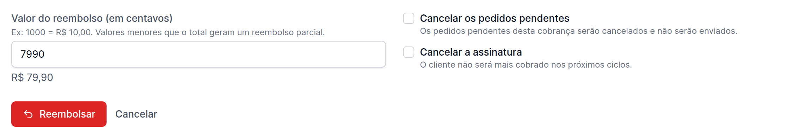

Administradores e proprietários podem reembolsar uma cobrança direto da ficha
dela, sem entrar no painel do provedor. O valor pode ser total ou parcial, com
mais de um reembolso parcial por cobrança, e no mesmo passo você escolhe se quer
cancelar o pedido pendente e a assinatura. O assinante recebe um email do
reembolso.

A nova tela **Reembolsos** lista todos, com filtros e exportação, inclusive os
feitos no painel do provedor, que continuam chegando sozinhos.

