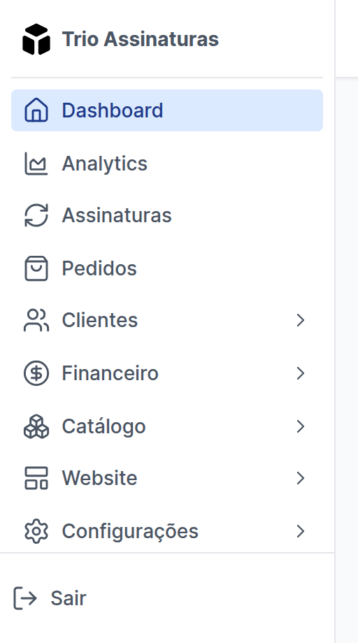

O menu lateral do painel passou a ter dois níveis. Dashboard, Analytics,
Assinaturas e Pedidos continuam à mão no primeiro nível, porque são o dia a
dia. O resto se organiza em cinco seções, **Clientes**, **Financeiro**,
**Catálogo**, **Website** e **Configurações**, cada uma abrindo a própria lista
ao ser clicada. Configurações voltou a conter só o que o nome diz.

