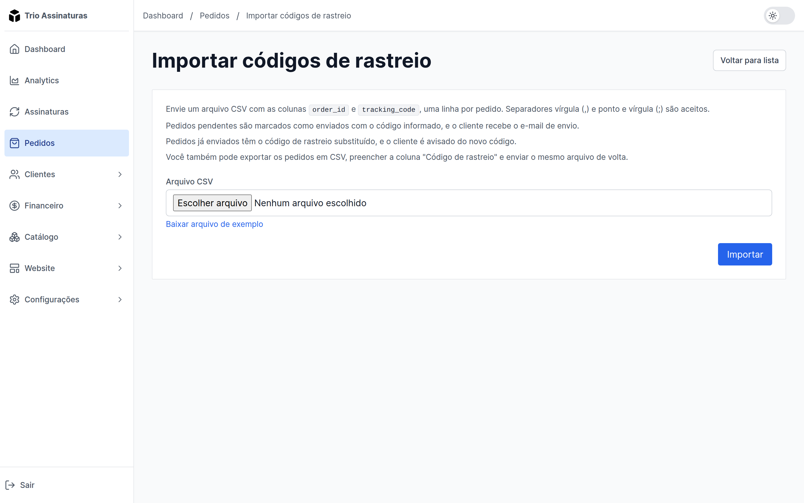

Em **Pedidos**, o botão **Importar rastreios** recebe um CSV com o ID de cada
pedido e o seu código de rastreio. Os pedidos pendentes são marcados como
enviados já com o código, e o cliente recebe o email de envio. Pedidos já
enviados têm o código trocado, e o cliente é avisado do novo rastreio.

O arquivo pode ser a própria exportação de pedidos, com a coluna **Código de
rastreio** preenchida. Ao terminar, a tela mostra o que mudou e lista as linhas
que não entraram, com o motivo e um link para a ficha de cada pedido.

