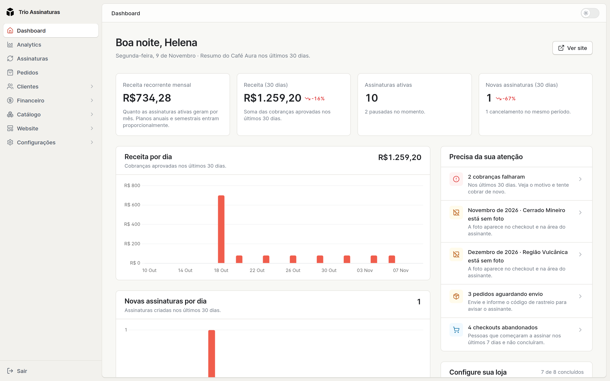

O Dashboard agora abre com o que importa no dia: a receita recorrente mensal, a
receita e as novas assinaturas dos últimos 30 dias comparadas com o mês
anterior, e o bloco **Precisa da sua atenção**, que avisa sobre cobranças com
falha, pedidos esperando envio, kits sem produtos ou sem foto, o mês que ainda
não tem kit e assinantes prestes a cancelar. Enquanto a loja não está completa,
o bloco **Configure sua loja** mostra os passos que faltam. Em todas as listas,
os filtros ficam no botão **Filtros**, ao lado da busca, e clicar em qualquer
ponto da linha abre o registro.

O checkout ganhou etapas numeradas, planos em cartões e um resumo do pedido com
a foto do kit, e a área do assinante abre direto na assinatura, com o próximo
kit, a próxima cobrança e o rastreio do pedido a caminho.

