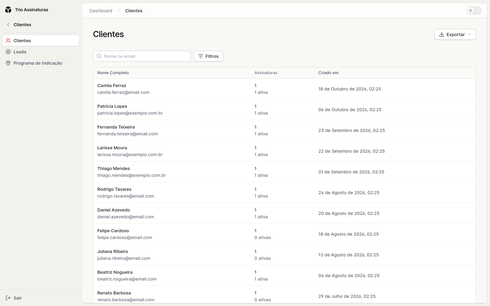
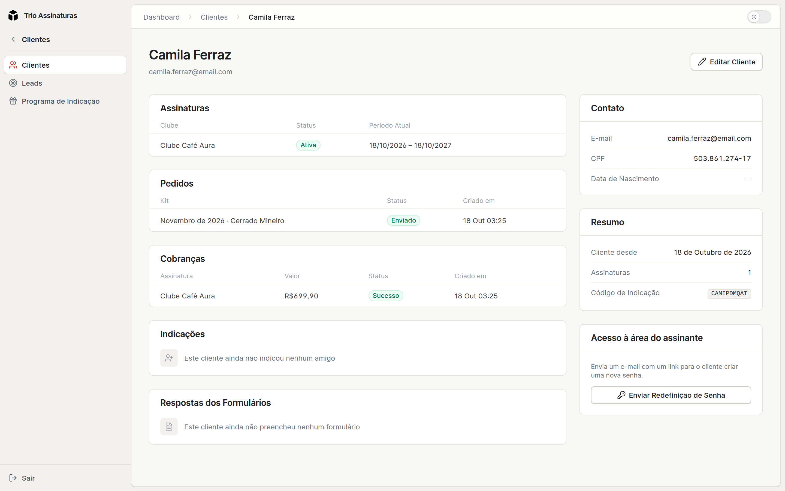
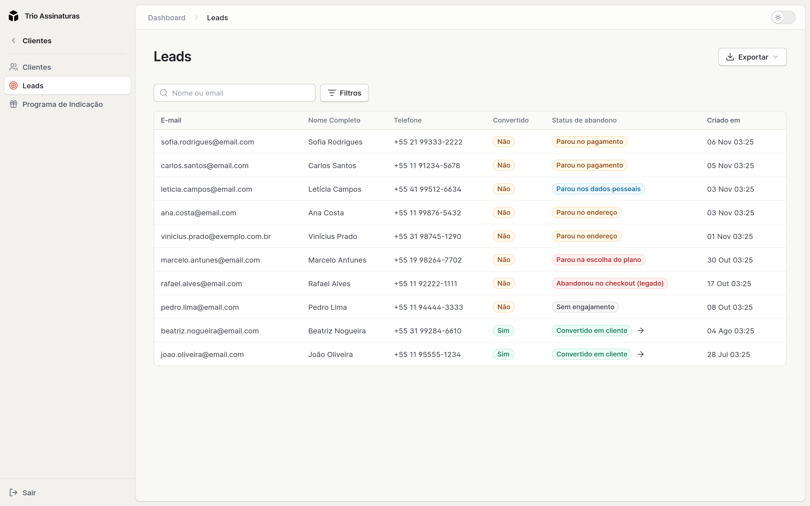

Duas telas, dois momentos da mesma pessoa: **Leads** são quem começou a assinar,
**Clientes** são quem completou.

## Clientes

A ficha reúne tudo sobre a pessoa: dados de contato, CPF, telefone, data de
nascimento, endereços, assinaturas, pedidos, cobranças, respostas de formulários
e indicações. A lista pode ser filtrada pela situação da assinatura (ativa,
cancelada, ou sem assinatura) e exportada em CSV e XLSX.

Na ficha, **Enviar redefinição de senha** manda um novo link de senha para
quando a pessoa não consegue entrar na área do assinante.

<Callout type="info" title="O documento é o CPF do assinante">
  O campo valida formato e dígitos verificadores de CPF, e pode ficar vazio.
</Callout>

<Callout type="tip" title="A data de nascimento chega de três lugares">
  Ela pode vir de um quiz respondido antes de assinar (o lead leva o dado para a
  ficha de cliente na conversão), ser editada por você na ficha, ou ser
  preenchida pelo próprio assinante em **Perfil**, na área dele. Serve bem para
  campanha de aniversário.

O checkout **não** pergunta data de nascimento, e ela também não sai na
exportação de clientes. Para uma campanha de aniversário, o caminho é a ficha ou
um quiz.

</Callout>

<Callout type="warning" title="O mesmo CPF pode ter duas fichas">
  Quem já é cliente e volta ao checkout com **outro email** vira um cliente novo,
  mesmo usando o mesmo CPF: a plataforma identifica pessoas pelo email. As duas
  fichas ficam separadas, cada uma com o seu histórico.

Quando alguém disser que “sumiu tudo”, esse é o primeiro palpite: procure pelo
CPF na busca e veja se existem duas fichas.
[Checkout](/docs/vendas/checkout).

</Callout>

## Leads

Todo mundo que começa o checkout entra aqui, com a **etapa mais distante** que
alcançou e o **status de abandono** correspondente. A lista se atualiza em tempo
real, e pode ser filtrada por convertidos e não convertidos.

O lead guarda email, nome, telefone e **CPF**, conforme a pessoa vai preenchendo
o checkout, além das respostas de formulário que ela tenha dado. Quando ela
completa a assinatura, o lead é promovido a cliente automaticamente, levando
junto as respostas que tenha dado antes.

O que cada status quer dizer, o que fazer com cada parada e como ler os leads
antigos está em [O funil de leads](/docs/operacao/funil-de-leads).

<Callout type="tip" title="O relatório mais acionável do painel">
  Filtre os leads não convertidos e olhe em que etapa eles pararam. Muita gente
  parando em **endereço** costuma significar frete alto ou CEP sem cobertura.
  Muita gente parando em **pagamento** aponta para cartão recusado ou dúvida
  sobre a recorrência. É informação que se transforma em ajuste concreto.
</Callout>

## Boas-vindas

Na primeira assinatura, o cliente recebe um email de boas-vindas. A partir daí a
comunicação segue os eventos da assinatura, descritos em
[Formulários e emails](/docs/recursos/formularios-e-emails).

## Filtros, ordenação e exportação

Todas as listas do painel seguem o mesmo padrão: uma busca por texto no alto, o
botão **Filtros**, que abre um menu com os filtros de período e de situação (e
mostra quantos estão em uso), **Limpar filtros** dentro desse menu, ordenação
por coluna, paginação e exportação em **CSV** e **XLSX**. Clicar em qualquer
ponto de uma linha abre o registro. Aprendendo em uma tela, você sabe usar todas.

A exportação de leads traz a coluna **Status de abandono**, com o mesmo texto que
aparece na lista, entre **Convertido** e **Criado em**.
