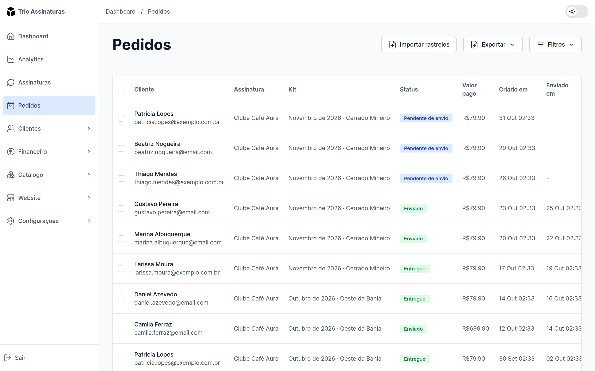
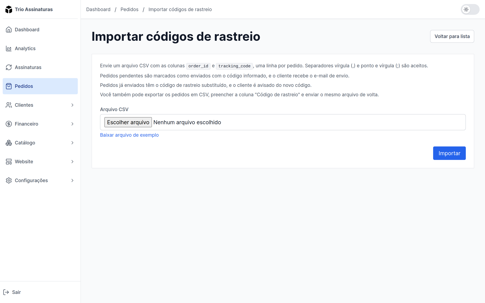
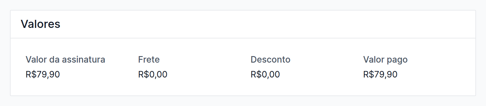

O **pedido** é a caixa a caminho. Ele nasce de uma cobrança paga e caminha até a
porta do assinante. A tela fica em **Pedidos**.

## Como os pedidos aparecem

Você não cria pedidos à mão: eles são gerados automaticamente quando uma cobrança
é paga, já com o kit do período, o endereço de entrega e o número da entrega
dentro da assinatura.

## Os estados

Todo pedido percorre estes quatro estados, sempre começando em Pendente de
envio:

| Estado                | Significa                                           |
| --------------------- | --------------------------------------------------- |
| **Pendente de envio** | esperando ser despachado. É onde todo pedido começa |
| **Enviado**           | despachado, normalmente com código de rastreio      |
| **Entregue**          | chegou                                              |
| **Cancelado**         | não será enviado                                    |

## Ações em lote

É aqui que a operação ganha tempo. As três ações funcionam tanto em um pedido
quanto em vários selecionados:

- **Enviar pedidos selecionados**, para marcar o lote como despachado.
- **Entregar pedidos selecionados**, para dar baixa quando a entrega confirma.
- **Cancelar pedidos selecionados**, ação reservada a Administrador e
  Proprietário. Veja [Equipe e
  acessos](/docs/primeiros-passos/equipe-e-acessos).

As transições respeitam o estado atual: só pedidos pendentes podem ser enviados,
só enviados podem ser entregues, e pedidos já entregues ou cancelados não podem
ser cancelados de novo.

## Código de rastreio

O campo é livre, sem formato obrigatório. O comportamento dos emails é o que
importa:

- Ao **marcar como enviado**, o cliente recebe o email de pedido enviado.
- Ao **editar o rastreio de um pedido já enviado**, o cliente recebe um email
  específico avisando que o código foi adicionado.

Na área do assinante, o pedido com rastreio ganha um link direto para consultar
nos Correios.

<Callout type="tip" title="A ordem que gera menos email">
  Informe o código de rastreio já no momento do envio: sai um email só. Enviar
  primeiro e preencher o rastreio depois manda dois emails, e é o que acontece
  no botão de envio em lote, que não aceita código. Para enviar vários pedidos
  já com o código, use a [importação por
  planilha](#importar-rastreios-por-planilha).
</Callout>

## Importar rastreios por planilha

A importação de rastreios envia vários pedidos de uma vez, cada um com o seu
código, a partir de um arquivo CSV. É o caminho para quem recebe os códigos da
transportadora ou do sistema de etiquetas numa planilha. Fica em **Pedidos**, no
botão **Importar rastreios**, e qualquer pessoa da equipe pode usar.

### O formato do CSV

O arquivo de rastreios tem uma linha por pedido e duas colunas obrigatórias, com
estes nomes no cabeçalho:

| Coluna             | Nomes aceitos no cabeçalho              |
| ------------------ | --------------------------------------- |
| ID do pedido       | `order_id` ou `ID`                      |
| Código de rastreio | `tracking_code` ou `Código de rastreio` |

Outras colunas são ignoradas. Vírgula e ponto e vírgula funcionam como
separador, então uma planilha salva como CSV no Excel entra sem ajuste. A tela
oferece um arquivo de exemplo para baixar, e cada arquivo aceita até 5.000
linhas.

<Callout type="tip" title="Exporte, preencha e importe de volta">
  O jeito mais rápido de montar o arquivo é exportar os pedidos em CSV,
  preencher a coluna **Código de rastreio** dos pedidos que vão sair e enviar o
  mesmo arquivo de volta. Linhas sem código são ignoradas, e pedidos que já têm
  aquele código continuam como estão.
</Callout>

### O que acontece com cada pedido

O efeito de cada linha depende do estado do pedido no momento da importação:

| Estado do pedido              | O que a importação faz                                                                                   |
| ----------------------------- | -------------------------------------------------------------------------------------------------------- |
| **Pendente de envio**         | marca como enviado, com o código, e o cliente recebe o email de pedido enviado                           |
| **Enviado**                   | troca o código, e o cliente recebe o email avisando do novo rastreio. Se o código for o mesmo, nada muda |
| **Entregue** ou **Cancelado** | não altera o pedido. A linha aparece como erro, a não ser que o pedido já tenha exatamente aquele código |

### O resultado da importação

A importação aplica o arquivo linha por linha: as linhas certas entram mesmo que
outras tenham problema. Ao terminar, a tela mostra quantos pedidos foram marcados
como enviados, quantos rastreios foram atualizados, quantos ficaram sem
alteração, quantas linhas vieram sem código e quantas tiveram erro.

As linhas com erro aparecem numa lista com o número da linha no arquivo e o
motivo: pedido não encontrado, ID em branco, pedido repetido no arquivo (vale a
primeira linha) ou estado que não aceita rastreio. Quando o pedido existe, o ID
na lista abre a ficha dele, para você conferir o caso antes de corrigir a
planilha.

<Callout type="info" title="Enviar o mesmo arquivo de novo é seguro">
  Depois de corrigir as linhas com erro, você pode importar o arquivo inteiro
  outra vez. Os pedidos que já foram enviados com aquele código ficam como
  estão, e nenhum cliente recebe email repetido.
</Callout>

## Os valores do pedido

A ficha do pedido mostra, no bloco **Valores**, quanto aquele pedido rendeu:
**Valor da assinatura**, **Frete**, **Desconto** e **Valor pago**. A lista de
pedidos traz o **Valor pago** de cada um numa coluna própria.

Quando uma cobrança paga várias entregas de uma vez, como num plano anual pago
de uma só vez, cada pedido mostra a sua parte do valor, e o bloco indica qual
entrega ele é, por exemplo “Entrega 3 de 12 da cobrança”. As partes dos pedidos
somam exatamente o que foi cobrado. Pedidos de cobranças mais antigas, feitas
antes de a plataforma guardar essa divisão, mostram os valores em branco.

## Filtros e exportação

Como as outras listas do painel, os pedidos têm busca, filtros de estado e de
data, ordenação por coluna e exportação em **CSV** e **XLSX**. A exportação é o
caminho natural para passar o lote do dia para quem faz a separação e a postagem.

Algumas colunas da exportação valem destaque para quem monta etiquetas:

- **Cardinalidade**: qual entrega aquele pedido é dentro da assinatura (1 é a
  primeira). Ajuda a identificar quem está recebendo a primeira caixa e merece um
  mimo de boas-vindas.
- **Brinde (SKU)** e **Brinde (Nome)**: o produto que vai junto na caixa, quando
  o assinante usou um [cupom de brinde](/docs/vendas/cupons#cupons-de-brinde).
  Só o primeiro pedido da assinatura tem brinde.
- O endereço vem **quebrado em partes** (CEP, rua, número, complemento, cidade,
  estado, país), em vez de uma linha só, o que é o formato que os sistemas de
  etiqueta e das transportadoras esperam.

A exportação também traz **Valor da Assinatura**, **Valor do Frete** e **Valor do
Desconto** de cada pedido, com a mesma divisão da ficha, o que permite fechar o
faturamento por pedido numa planilha.

O frete de cada pedido vem da
[tabela de frete](/docs/operacao/tabelas-de-frete) do clube, e é cobrado em cada
cobrança, registrado separadamente do valor da assinatura.
