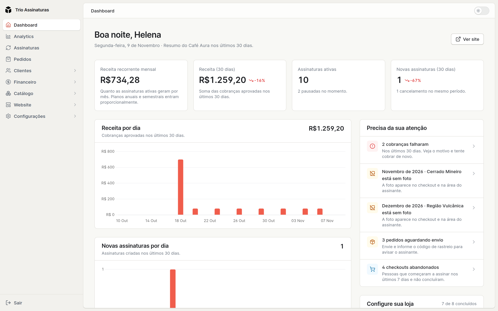
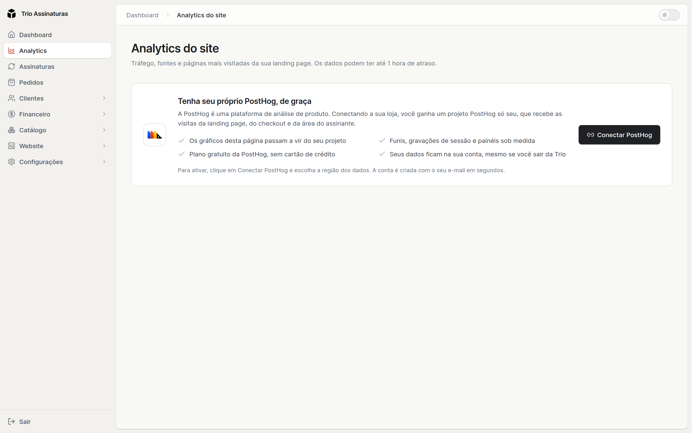

A plataforma mostra os números do seu clube em duas telas: **Dashboard**, com a
saúde da operação, e **Analytics**, com o tráfego que vira assinatura. O
Dashboard funciona desde o primeiro dia; o Analytics mostra os dados do seu
projeto na PostHog, que você conecta em poucos cliques.

## Dashboard

O Dashboard é a tela inicial do painel e responde a duas perguntas: como o clube
está indo e o que precisa de você hoje. No alto ficam quatro indicadores, cada
um com um link para a lista que explica o número:

- **Receita recorrente mensal**: quanto as assinaturas ativas geram por mês.
  Planos anuais e semestrais entram proporcionalmente, então um plano anual
  conta um doze avos do preço.
- **Receita (30 dias)**: a soma das cobranças aprovadas nos últimos 30 dias.
- **Assinaturas ativas**, com quantas estão pausadas no momento.
- **Novas assinaturas (30 dias)**, com quantos cancelamentos houve no mesmo
  período.

A receita e as novas assinaturas vêm comparadas com os 30 dias anteriores, para
você ver se o mês está melhor ou pior que o passado.

Abaixo dos indicadores ficam dois gráficos dos últimos 30 dias, **Receita por
dia** e **Novas assinaturas por dia**, e a **Atividade recente**, com o que
aconteceu nos últimos 7 dias: assinaturas novas, cobranças aprovadas ou com
falha, pedidos criados e checkouts começados ou concluídos.

### Precisa da sua atenção

O bloco **Precisa da sua atenção** lista o que pede uma ação sua, do mais urgente
para o menos urgente. Cada item leva à tela onde você resolve:

| Aviso                                       | O que fazer                                                                     |
| ------------------------------------------- | ------------------------------------------------------------------------------- |
| **Nenhum kit para** (mês)                   | cadastrar o kit do mês atual ou do próximo, senão os assinantes ficam sem envio |
| **assinantes podem ser cancelados**         | pedir que atualizem o pagamento: as últimas renovações deles falharam           |
| **cobranças falharam**                      | ver o motivo e tentar cobrar de novo (conta os últimos 30 dias)                 |
| **Pix ou boletos sem pagamento**            | lembrar o assinante: foram gerados há mais de 2 dias                            |
| (kit) **está sem produtos** ou **sem foto** | completar o kit do mês atual ou do próximo                                      |
| **pedidos aguardando envio**                | enviar e informar o código de rastreio                                          |
| **checkouts abandonados**                   | olhar quem começou a assinar nos últimos 7 dias e não concluiu                  |
| **assinaturas voltam da pausa**             | incluir esses assinantes no envio da semana                                     |
| **planos avulsos terminam em breve**        | oferecer uma nova assinatura: esses planos não renovam sozinhos                 |

Quando não há nada pendente, o bloco mostra **Tudo em dia**.

### Configure sua loja

Enquanto a loja não está completa, administradores e o dono veem o bloco
**Configure sua loja**, uma lista de passos com o progresso feito: enviar o
logo, publicar o site, verificar o domínio de email, conectar uma ferramenta de
análise ou de anúncios, configurar o frete, ativar o programa de indicação,
preencher o título e a descrição do site e enviar um favicon. O bloco some
quando todos os passos estão concluídos.

### Próximos envios

O bloco **Próximos envios** mostra os kits que os assinantes ativos vão receber a
seguir, com o período de cada kit e quantos assinantes o recebem. É o atalho
para saber quantas caixas montar.

## Analytics

A tela de **Analytics** mostra o tráfego do clube, com os gráficos do seu
projeto na PostHog. Enquanto a PostHog não está conectada, a tela convida quem
administra a loja a conectá-la, e os demais usuários veem um aviso para pedir
isso a um administrador. O passo a passo está em
[Integrações](/docs/recursos/integracoes#como-conectar-a-posthog). Se a
integração for desativada, os gráficos somem até você ativá-la de novo.

Com a PostHog conectada, a tela traz estes gráficos, com janelas de 7, 30 e 90
dias:

- visitas por dia
- origens do tráfego e campanhas (UTM)
- sites que mandaram visita
- páginas mais vistas
- **funil de checkout**: quantos chegaram ao checkout, quantos concluíram e
  quantos abandonaram

<Callout type="tip" title="Dois funis que se completam">
  O funil do Analytics conta visitas; a lista de **Leads** conta pessoas com
  nome e email, e mostra em qual etapa cada uma parou. Use o Analytics para
  saber **quanto** você perde e de onde vem quem converte, e [O funil de
  leads](/docs/operacao/funil-de-leads) para saber **quem** parou e **onde**.
</Callout>

Os números do Analytics são recalculados a cada 15 minutos, das 8h às 18h
(horário de Brasília), então podem levar alguns minutos para refletir algo que
acabou de acontecer. Para ver os dados mais recentes ou montar análises
próprias, o botão **Abrir na PostHog** leva você direto ao projeto, já com a
sessão iniciada. Lá você encontra os
[painéis prontos](/docs/recursos/integracoes#os-painéis-prontos) da loja, do
checkout, da área do assinante e do site, e as gravações das sessões dos
visitantes.

## O que roda sozinho

Para referência, as rotinas automáticas da plataforma:

Os horários são de Brasília.

| Rotina                                                              | Frequência                       |
| ------------------------------------------------------------------- | -------------------------------- |
| Reativar assinaturas pausadas cuja data de volta chegou             | uma vez por dia, às 2h           |
| Processar as cobranças do dia                                       | uma vez por dia, às 3h           |
| Lembrar assinantes cuja pausa termina em três dias                  | uma vez por dia, às 9h           |
| Retentar tentativas de cobrança que falharam                        | a cada 6 horas                   |
| Conferir PIX aguardando pagamento e destravar assinaturas pendentes | a cada hora                      |
| Criar pedidos de cobranças pagas que ficaram sem pedido             | a cada 15 minutos                |
| Atualizar os números do Analytics                                   | a cada 15 minutos, das 8h às 18h |
| Lembrar a equipe de configurar o domínio de envio de emails         | todo dia 1º, às 10h              |

Sobre cobranças e retentativas, veja
[Pagamentos e retentativas](/docs/cobrancas/pagamentos-e-retentativas). Sobre
a pausa, [Assinaturas](/docs/cobrancas/assinaturas). Sobre o domínio de envio,
[Domínio de envio de emails](/docs/primeiros-passos/dominio-de-email).
